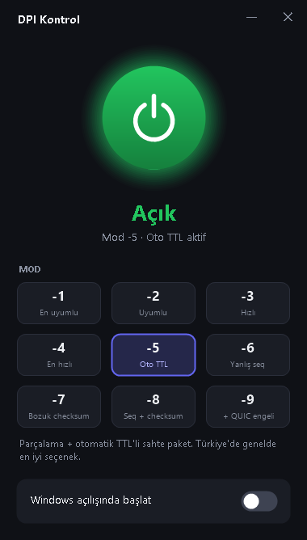

# DPI Kontrol

[GoodbyeDPI](https://github.com/ValdikSS/GoodbyeDPI) için Windows'ta tek tıkla aç/kapat yapan küçük bir arayüz. Kurulum yok, ek program gerekmez; PowerShell ile çalışır.



## Özellikler

- Büyük güç butonuyla GoodbyeDPI hizmetini açma/kapatma
- GoodbyeDPI'ın 9 modu (`-1` … `-9`) arasında tek tıkla geçiş; hizmet açıksa yeni modla otomatik yeniden başlar
- "Windows açılışında başlat" anahtarı
- Sistem tepsisi simgesi (açıkken yeşil, kapalıyken gri), sağ tık menüsü
- Mevcut ayarı hizmetten okur, durumu 2 saniyede bir günceller

## Kurulum

1. [GoodbyeDPI](https://github.com/ValdikSS/GoodbyeDPI/releases) (veya Türkiye sürümü) indirip bir klasöre çıkar.
2. Bu depodaki `DPI-Kontrol.ps1` ve `DPI-Kontrol.vbs` dosyalarını **aynı klasöre** koy. Klasör yapısı şöyle olmalı:
   ```
   goodbyedpi/
   ├── DPI-Kontrol.ps1
   ├── DPI-Kontrol.vbs
   └── x86_64/
       ├── goodbyedpi.exe
       ├── WinDivert.dll
       └── WinDivert64.sys
   ```
3. `DPI-Kontrol.vbs`'ye çift tıkla, yönetici iznine "Evet" de. İstersen masaüstüne kısayolunu oluştur.

Hizmeti yönetebilmek için yönetici izni gerekir. Uygulama `GoodbyeDPI` adlı Windows hizmetini kullanır; yoksa kendisi oluşturur.

## Modlar

| Mod | Açıklama |
|---|---|
| -1 | HTTP/HTTPS'i küçük parçalara böler. En uyumlu ama yavaş |
| -2 | -1 gibi, HTTPS parçaları daha büyük |
| -3 | Sadece HTTPS parçalanır, HTTP başlık hileleri. Hızlı |
| -4 | Parçalama yok, sadece başlık hileleri. En hızlı |
| -5 | Parçalama + otomatik TTL'li sahte paket |
| -6 | Sahte paket yanlış sıra numarasıyla |
| -7 | Sahte paket bozuk checksum ile |
| -8 | Yanlış sıra numarası + bozuk checksum |
| -9 | -8 + QUIC/HTTP3 engeli |

## Kaldırma

Uygulamayı kapatman yeterli. GoodbyeDPI hizmetini tamamen kaldırmak için yönetici PowerShell'de:

```powershell
sc.exe stop GoodbyeDPI; sc.exe delete GoodbyeDPI
```

## Lisans

Bu arayüz MIT lisanslıdır. GoodbyeDPI ve WinDivert bu depoya dahil değildir; kendi lisanslarına tabidir.
